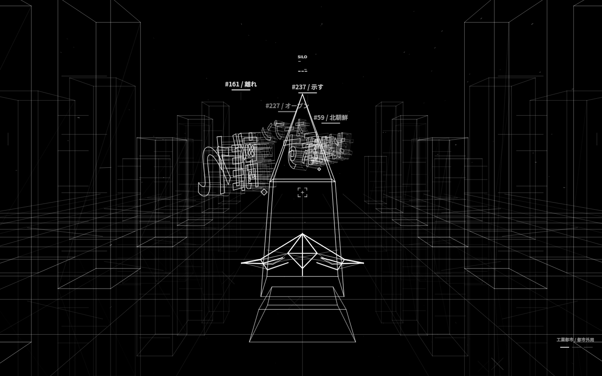
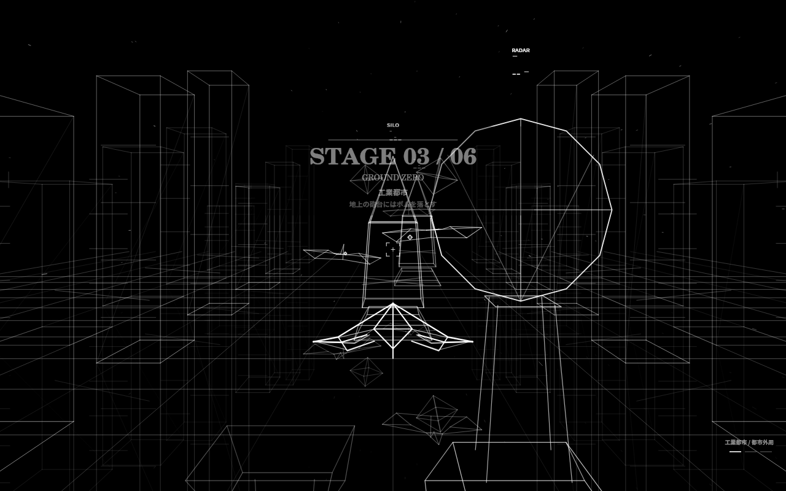
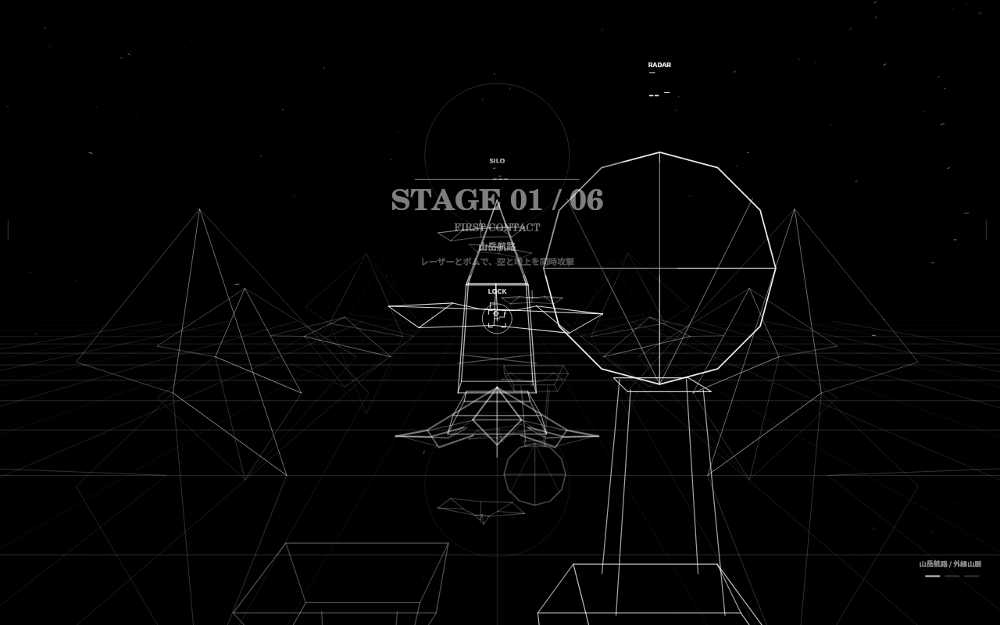
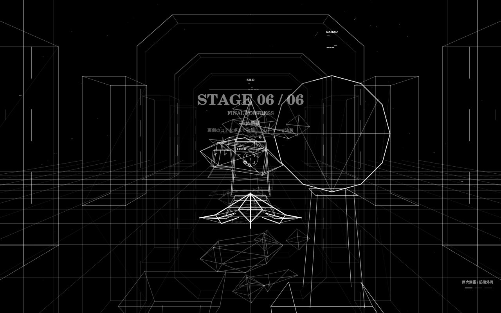
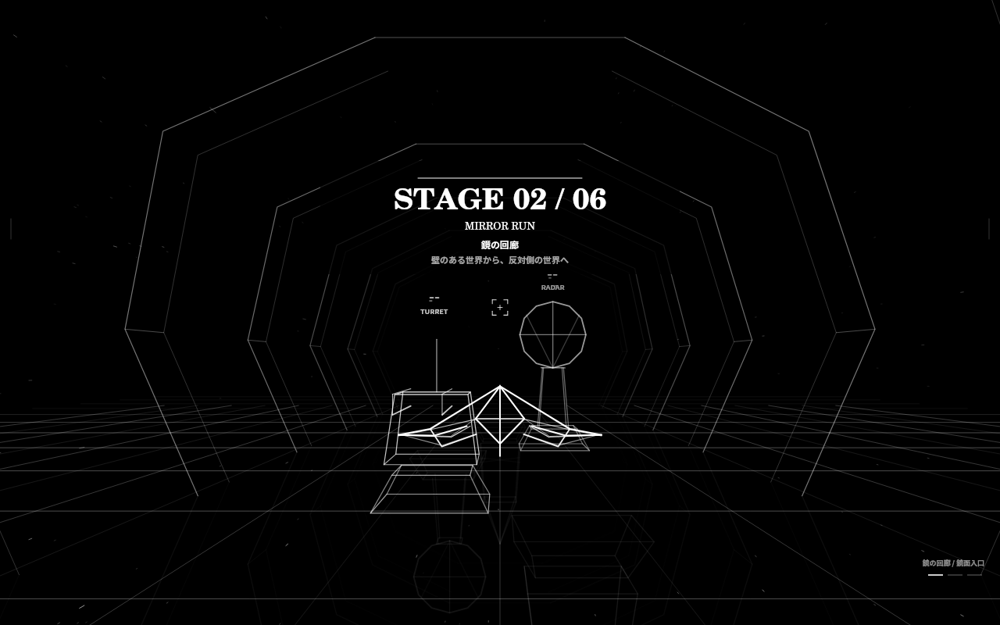

# JIJI FIGHTER / ジジファイター

Japanese current topics become three-dimensional wireframe enemies. Fly between two mirrored worlds, fire lasers and bombs, and break through six monochrome stages.

**v0.11.4 · Installable PWA · PC / mobile · Japanese topics worldwide**

**[PLAY JIJI FIGHTER / ゲームを起動](https://jiji-fighter.pages.dev/)** · [Source code](https://github.com/Masato-Nasu/JIJI-FIGHTER) · [LIVE WORDS API](https://jiji-fighter.pages.dev/api/trends)

*The public play link requires a successfully deployed Cloudflare Pages site; GitHub alone does not host the live-topic API.*



*Gameplay Canvas capture with multiple demo Japanese words for visual clarity. The screenshot is staged for documentation; actual TREND play uses live feeds and does not substitute sample words.*

## Game screens



| Mountain sector | Final fortress |
| --- | --- |
|  |  |



## Features

- Six distinct environments, each evolving through three sections.
- Japanese kanji, hiragana and katakana enemies built from font outlines.
- Live topics from Google Trends Japan, public Bluesky and Japanese news RSS.
- A mirrored underside reached by an automatic aircraft roll.
- Simultaneous lasers and bombs, three hull difficulty settings, stage practice.
- Aircraft explosion on wall collision or hull depletion.
- Original looping BGM **MAZZ DB 2017**, composed by Masato Nasu. MUSIC starts when START is tapped; SFX controls effects only.
- PWA manifest, home-screen icons and offline CLASSIC mode after initial caching.

Ranks are the game's combined order of search terms, social topics and news-derived words, **not a single verified popularity ranking**. Live topic availability depends on the upstream services. TREND requires an internet connection; synthetic sample words are never substituted. Topics remain Japanese regardless of the player's country.

## Play locally on Linux / Linuxで起動

Node.js 22+ is required. No npm dependencies or API keys are needed.

```bash
git clone https://github.com/Masato-Nasu/JIJI-FIGHTER.git
cd JIJI-FIGHTER
bash start-linux.sh
```

The browser opens automatically. Keep the terminal open; press Ctrl+C to stop. Initial topic loading can take around 30 seconds. Use the server, not `file://`, for TREND mode.

## Publish on Cloudflare Pages / 公開

GitHub hosts the source. **GitHub Pages alone cannot run the bundled topic API.** Deploy the static files and Pages Function together on Cloudflare Pages.

From this repository's root:

```bash
node build.mjs
npx wrangler pages deploy dist --project-name jiji-fighter --branch main
```

Sign in to Cloudflare when prompted. If the project does not exist, create `jiji-fighter` when Wrangler asks. The command prints the actual deployment URL. Keep the `functions/` folder in the repository root when deploying. No API keys, paid X integration, or environment variables are required.

For Git integration: build command `node build.mjs`, output directory `dist`, root directory `/`.

The play URL above is the configured Cloudflare Pages address. Availability must be verified after deploying; the GitHub repository itself does not serve the live API.

## BGM / 音楽

The original MP3 plays locally when **START MISSION** is tapped, and loops throughout gameplay at a reduced 28% volume. **MUSIC ON / OFF** controls background music. Sound effects start **ON** at reduced volume; the **SFX ON / OFF** button controls effects only. **STOP GAME** (next to PAUSE) exits the mission and returns to the title. On a fatal hit, music continues through the 2.4-second explosion, plays for 0.8 seconds more and fades over 0.65 seconds; the recording is saved after the fade. Manual STOP GAME remains immediate. If a phone blocks playback, tap **TAP MUSIC** once to retry. Recording mode retains a live audio track for video capture, including subsequent takes. Desktop/mobile browser tests decode six saved recordings and verify non-silent audio; real phone gallery playback depends on the file's codec support.

スマホでは **START MISSION** を押すとBGMが始まり、控えめな音量でループ再生されます。**SFXは初期ON**で、音量を下げています。**STOP GAME** を押すと開始画面に戻り、音楽も停止します。撃墜時は爆発中もBGMが続き、爆発後に約0.8秒の余韻を置いて約0.65秒でフェードアウトします。その後、録画を自動保存します。音が止まっている場合は **TAP MUSIC** を押してください。SFXは効果音だけの切り替えです。スマホの標準ギャラリーでWebM（Opus音声）の再生に対応していない場合は、ブラウザや対応する動画プレーヤーで開いてください。更新が見えない場合は、インストール済みアプリを一度完全に閉じて再度開いてください。

## Install / ホーム画面に追加

Open the HTTPS deployment. On supported Chrome/Edge browsers use **INSTALL / アプリを追加** or the browser's install menu. On iPhone use Safari → Share → Add to Home Screen. Browser install options vary.

After the first complete online load and caching, CLASSIC can launch offline. TREND always needs internet. Updates activate after existing game windows are closed, without interrupting a mission. Local Linux ports may change between runs; install the published HTTPS version for a stable app address.

## Controls

| Action | PC | Mobile |
| --- | --- | --- |
| Move | WASD / arrow keys | Drag the left side |
| Laser + bomb | Hold Space or B | Hold ATTACK |
| Pause | P / Escape | PAUSE |
| Stop game / return to title | STOP GAME | STOP GAME |

Cross the mirror plane to enter the other world. Walls destroy the aircraft on every difficulty. Decorative buildings have no collision.

## Credits and rights

Game and original music: **Masato Nasu**. Music: [MAZZ DB 2017](https://soundcloud.com/android-shaman/mazz-db-2017).

The game bundles **opentype.js** (MIT) and **Noto Sans JP** (SIL Open Font License). Existing embedded attribution is retained. No blanket open-source license is granted for the game or music by this repository.

Documentation images are captured from the game's Canvas; the lead image is a staged demo of multiple word enemies rather than a claim about the live ranking at the moment of capture.
